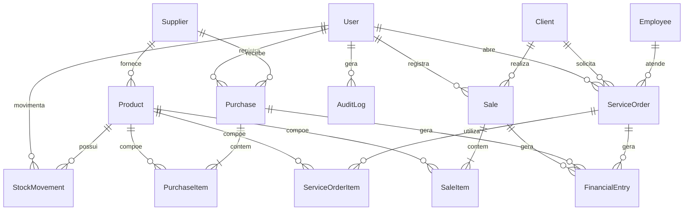

# GestãoPro — Sistema de Gerenciamento Empresarial (ERP)

Sistema ERP web completo, minimalista (tema **Preto & Branco** com modo Claro/Escuro) e pronto para uso local ou em servidor, desenvolvido com **Next.js 16 (App Router + Server Actions)**, **TypeScript**, **Prisma ORM**, **SQLite** e **Lucide Icons**.

---

## Sumário

- [Visão Geral](#-visão-geral)
- [Funcionalidades por Módulo](#-funcionalidades-por-módulo)
- [Tecnologias Utilizadas](#-tecnologias-utilizadas)
- [Estrutura do Banco de Dados](#-estrutura-do-banco-de-dados)
- [Como Executar Localmente](#-como-executar-localmente)
- [Credenciais de Demonstração](#-credenciais-de-demonstração)
- [Scripts Disponíveis](#-scripts-disponíveis)
- [Estrutura de Pastas](#-estrutura-de-pastas)

---

## Visão Geral

O **GestãoPro** integra todas as áreas essenciais de uma pequena ou média empresa em uma única aplicação:

- **Comercial & Serviços:** Vendas, Orçamentos, Ordens de Serviço (OS) e Clientes.
- **Suprimentos & Logística:** Catálogo de Produtos/Serviços, Controle de Estoque, Compras e Fornecedores.
- **Gestão Financeira & RH:** Contas a Pagar/Receber, Fluxo de Caixa, Folha de Pagamento, DRE Simplificado e Relatórios.
- **Segurança & Governança:** Autenticação JWT com perfis de acesso (`ADMIN` e `FUNCIONARIO`), Configurações da Empresa e Log de Auditoria completo.

---

## Funcionalidades por Módulo

| Módulo | Rota | Principais Recursos |
| :--- | :--- | :--- |
| **Dashboard** | `/` | KPIs mensais (faturamento, recebido, pago, resultado de caixa), gráficos de 6 meses, OS em aberto, últimas vendas e alertas de estoque mínimo. |
| **Vendas** | `/vendas` | Orçamentos e pedidos com múltiplos itens e desconto. Confirmação baixa o estoque e gera lançamento financeiro (quitado para PIX/Dinheiro/Débito ou pendente para Boleto/Crédito). Cancelamento estorna estoque e financeiro. Inclui **Recibo/Pedido imprimível** (`/vendas/[id]/recibo`). |
| **Ordens de Serviço** | `/os` | Controle de assistência técnica/serviços com equipamento, nº de série, prioridade (`Baixa`, `Normal`, `Alta`, `Urgente`), status (`Aberta`, `Em andamento`, `Aguardando peça`, `Concluída`, `Cancelada`), laudo técnico, mão de obra e peças. Ao concluir, baixa as peças do estoque e lança a receita. Inclui **Comprovante de OS imprimível** (`/os/[id]/recibo`). |
| **Clientes** | `/clientes` | Cadastro completo (CPF/CNPJ, contato, endereço, observações), histórico de vendas e exclusão/inativação segura. |
| **Produtos** | `/produtos` | Catálogo com SKU único, categoria, unidade, preço de custo, preço de venda, cálculo automático de margem de lucro e estoque mínimo. |
| **Estoque** | `/estoque` | Valorização do estoque (a preço de custo e de venda), lista de produtos abaixo do mínimo e movimentações manuais (`Entrada`, `Saída` e `Ajuste de Inventário`). |
| **Compras** | `/compras` | Pedidos de compra a fornecedores com geração automática de conta a pagar e recebimento de mercadoria (soma ao estoque e atualiza o custo unitário). |
| **Fornecedores** | `/fornecedores` | Cadastro de fornecedores com listagem de produtos e compras vinculadas. |
| **Financeiro** *(Admin)* | `/financeiro` | Contas a pagar e a receber, geração de parcelas recorrentes mensais, destaque de títulos vencidos e baixa rápida com 1 clique. |
| **Funcionários / RH** *(Admin)* | `/funcionarios` | Cadastro de colaboradores por cargo/departamento e geração automática da folha salarial mensal no contas a pagar. |
| **Relatórios & DRE** *(Admin)* | `/relatorios` | DRE simplificado por período (receita bruta, descontos, CMV, lucro bruto, despesas operacionais por categoria e resultado líquido), vendas por pagamento/vendedor, top produtos e top clientes. |
| **Auditoria** *(Admin)* | `/auditoria` | Trilha de auditoria automática registrando logins, criações, edições, confirmações, baixas, cancelamentos e exclusões, com filtros por módulo e ação. |
| **Configurações** *(Admin)* | `/configuracoes` | Dados da empresa (Razão Social, Nome Fantasia, CNPJ, IE, endereço, contatos e rodapé personalizado) exibidos nos recibos e comprovantes de OS. |
| **Exportação CSV** | `/api/export` | Exportação das listagens em CSV (com BOM UTF-8 e separador `;`, pronto para abrir no Microsoft Excel em português). |

---

## Tecnologias Utilizadas

- **[Next.js 16](https://nextjs.org/)** (App Router, React Server Components & Server Actions)
- **[Django 5.2](https://www.djangoproject.com/) + [Django REST Framework](https://www.django-rest-framework.org/)** (Backend ORM integrado, Painel **Django Admin** customizado e API REST compartilhando o mesmo banco SQLite)
- **[React 19](https://react.dev/)** + **TypeScript**
- **[Prisma ORM 6](https://www.prisma.io/)** + **SQLite** (banco em arquivo local `prisma/dev.db`, compartilhado entre Next.js e Django)
- **[Lucide React](https://lucide.dev/)** (ícones vetoriais minimalistas)
- **[Jose](https://github.com/panva/jose)** & **[bcryptjs](https://github.com/dcodeIO/bcrypt.js)** (autenticação JWT em cookie `httpOnly` e hash de senhas)

---

## Backend Django & Django Admin (`django_backend/`)

O projeto possui um backend **Django** completo em `django_backend/` conectado diretamente ao mesmo banco SQLite (`prisma/dev.db`) utilizado pelo Next.js, com conversão automática de datas via `PrismaDateTimeField`.

### Iniciar o servidor Django (porta 8000)

```bash
npm run django
# ou diretamente:
python django_backend/manage.py runserver 8000
```

- **Django Admin:** `http://localhost:8000/admin/`
  - **Usuário:** `admin` | **Senha:** `admin123`
  - Inclui inlines de itens (Vendas, Compras e Ordens de Serviço) e ações em lote para **Confirmar vendas**, **Receber compras** e **Baixar lançamentos financeiros**.
- **API REST navegável (Django REST Framework):** `http://localhost:8000/api/`
  - `GET /api/resumo/` — KPIs consolidados do ERP via Django ORM
  - `GET/POST /api/clientes/`, `/api/fornecedores/`, `/api/produtos/`, `/api/funcionarios/`
  - `GET/POST /api/vendas/`, `/api/compras/`, `/api/os/`, `/api/estoque/`, `/api/financeiro/`, `/api/auditoria/`

---

## Estrutura do Banco de Dados



---

## Como Executar Localmente

### Pré-requisitos

- **Node.js** 18+ instalado

### Passo a passo

```bash
# 1. Clone o repositório
git clone <URL_DO_SEU_REPOSITORIO>
cd gestao-empresa

# 2. Instale as dependências
npm install

# 3. Configure as variáveis de ambiente
cp .env.example .env

# 4. Crie o banco SQLite e popule com os dados iniciais de demonstração
npm run setup

# 5. Inicie o servidor de desenvolvimento
npm run dev
```

Acesse **http://localhost:3000** no seu navegador.

---

## Credenciais de Demonstração

Após rodar `npm run setup` (ou `npm run db:seed`), utilize uma das contas abaixo na tela de login:

| Perfil | E-mail | Senha | Acesso |
| :--- | :--- | :--- | :--- |
| **Administrador** | `admin@empresa.com` | `admin123` | Completo (todos os módulos) |
| **Funcionário** | `func@empresa.com` | `func123` | Operacional (Dashboard, Vendas, OS, Clientes, Produtos, Estoque, Compras e Fornecedores) |

---

## Scripts Disponíveis

| Comando | Descrição |
| :--- | :--- |
| `npm run dev` | Inicia o servidor de desenvolvimento em `http://localhost:3000` |
| `npm run build` | Gera o build otimizado para produção |
| `npm run start` | Inicia o servidor em modo de produção |
| `npm run setup` | Cria as tabelas no SQLite (`prisma db push`) e roda o seed inicial |
| `npm run db:reset` | Zera o banco de dados e recarrega os dados de demonstração |
| `npm run db:studio` | Abre o **Prisma Studio** para visualizar/editar tabelas no navegador |

---

## Estrutura de Pastas

```text
gestao-empresa/
├── prisma/
│   ├── schema.prisma          # Modelagem completa do banco de dados
│   └── seed.mjs               # Dados iniciais de demonstração
├── src/
│   ├── app/
│   │   ├── (app)/             # Rotas autenticadas com Sidebar
│   │   │   ├── auditoria/     # Log de auditoria
│   │   │   ├── clientes/      # CRUD de clientes
│   │   │   ├── compras/       # Pedidos de compra e recebimento
│   │   │   ├── configuracoes/ # Dados cadastrais da empresa
│   │   │   ├── estoque/       # Saldos, alertas e inventário
│   │   │   ├── financeiro/    # Contas a pagar/receber e fluxo de caixa
│   │   │   ├── fornecedores/  # CRUD de fornecedores
│   │   │   ├── funcionarios/  # RH e geração da folha salarial
│   │   │   ├── os/            # Ordens de Serviço + comprovante imprimível
│   │   │   ├── perfil/        # Troca de senha do usuário logado
│   │   │   ├── produtos/      # Catálogo de produtos e serviços
│   │   │   ├── relatorios/    # DRE simplificado e rankings
│   │   │   ├── usuarios/      # Gestão de usuários e permissões
│   │   │   ├── vendas/        # Orçamentos, vendas e recibo imprimível
│   │   │   └── page.tsx       # Dashboard principal
│   │   ├── api/export/        # Endpoint de exportação CSV/Excel
│   │   ├── login/             # Tela e action de autenticação
│   │   ├── globals.css        # Tema Preto & Branco (Claro/Escuro) e impressão
│   │   └── layout.tsx         # Layout raiz
│   ├── components/            # Sidebar, ItemsEditor, Forms, gráficos e badges
│   ├── lib/                   # Prisma client, JWT auth, form helpers, auditoria
│   └── proxy.ts               # Proteção de rotas (redirecionamento para /login)
├── .env.example
├── package.json
└── tsconfig.json
```
