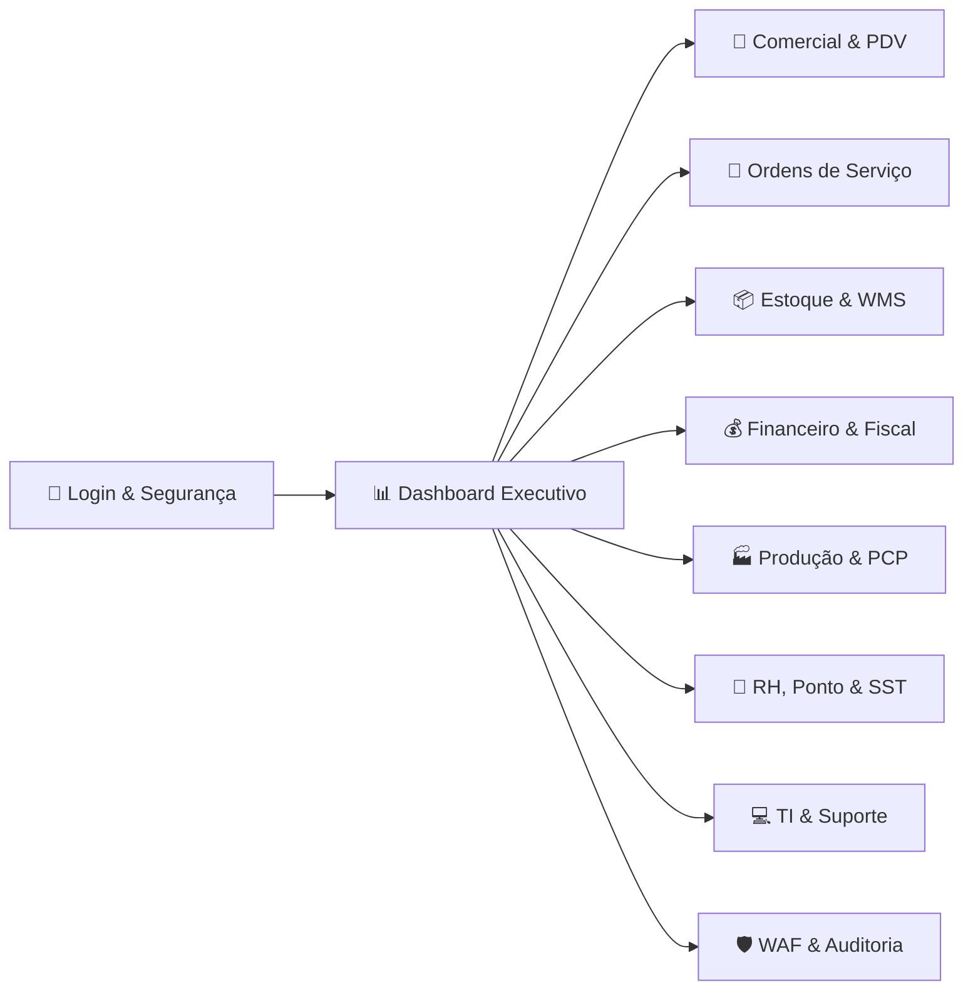
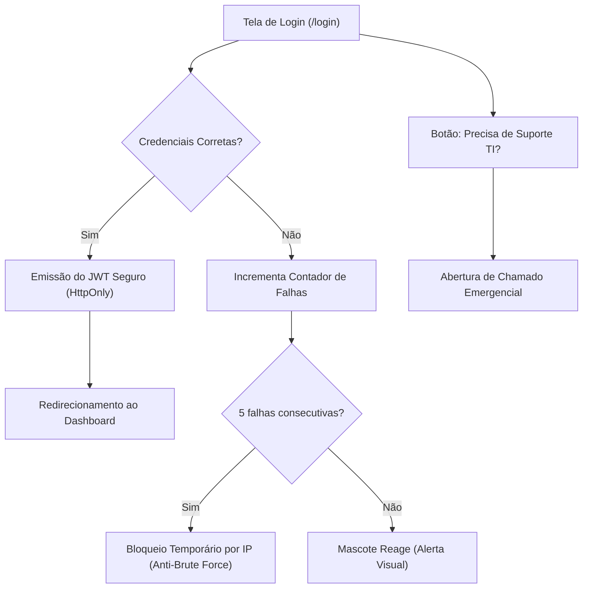
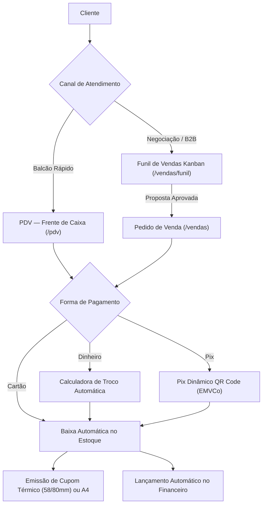
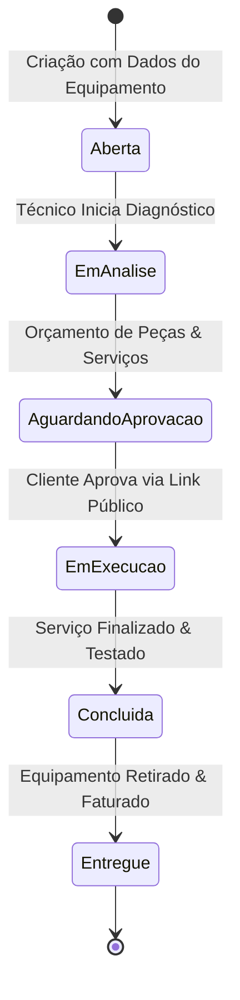
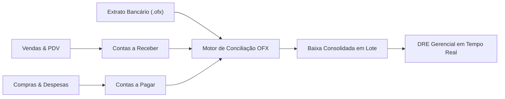
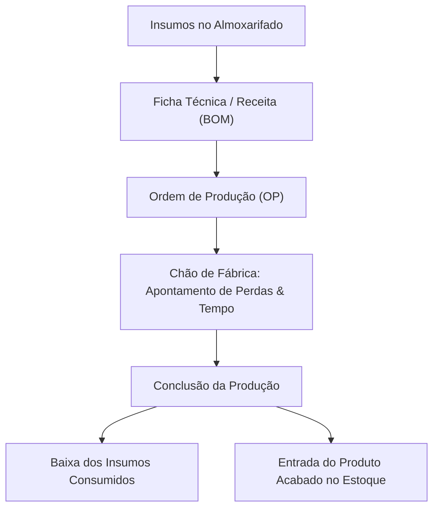
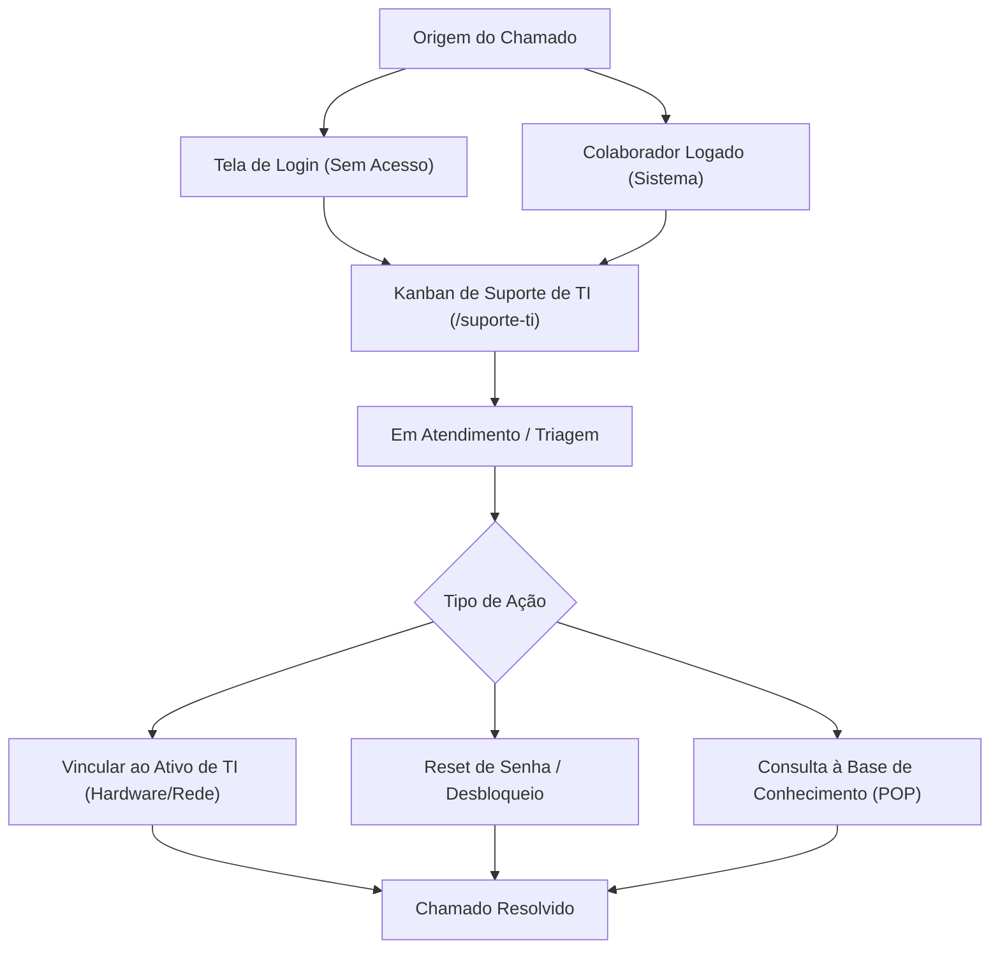
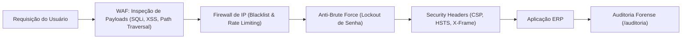

# Manual Operacional e Guia do Usuário — GestãoPro ERP

Seja bem-vindo ao manual completo de operação do **GestãoPro**, o sistema integrado de gestão empresarial corporativo desenvolvido em arquitetura moderna (Next.js 16, React 19, TypeScript, PostgreSQL e Prisma ORM).

Este guia tem como objetivo capacitar administradores, gestores operacionais, operadores de caixa, técnicos, almoxarifes, analistas de RH e profissionais de TI no uso eficiente, seguro e ágil de todos os módulos da plataforma.

---

## Sumário Executivo

1. [Acesso e Autenticação](#1-acesso-e-autenticação)
2. [Interface, Navegação e Atalhos Globais](#2-interface-navegação-e-atalhos-globais)
3. [Dashboard Executivo & Indicadores](#3-dashboard-executivo--indicadores)
4. [Módulo Comercial: PDV, Vendas e CRM](#4-módulo-comercial-pdv-vendas-e-crm)
5. [Módulo de Serviços: Ordens de Serviço (OS)](#5-módulo-de-serviços-ordens-de-serviço-os)
6. [Módulo de Suprimentos: Estoque, WMS, Compras e Recebimento](#6-módulo-de-suprimentos-estoque-wms-compras-e-recebimento)
7. [Módulo Financeiro & Conciliação OFX](#7-módulo-financeiro--conciliação-ofx)
8. [Módulo Fiscal: NF-e e NFC-e](#8-módulo-fiscal-nf-e-e-nfc-e)
9. [Módulo Industrial: PCP & Fábrica](#9-módulo-industrial-pcp--fábrica)
10. [Módulo de Recursos Humanos, REP 671 & SST](#10-módulo-de-recursos-humanos-rep-671--sst)
11. [Portal do Colaborador (Autoatendimento LGPD)](#11-portal-do-colaborador-autoatendimento-lgpd)
12. [Tecnologia da Informação (TI) & Helpdesk Interno](#12-tecnologia-da-informação-ti--helpdesk-interno)
13. [Segurança Cibernética, WAF & Trilha de Auditoria](#13-segurança-cibernética-waf--trilha-de-auditoria)
14. [Configurações, Usuários & Permissões (RBAC)](#14-configurações-usuários--permissões-rbac)
15. [Tabela de Atalhos Rápidos & Resolução de Problemas](#15-tabela-de-atalhos-rápidos--resolução-de-problemas)

---

## 1. Acesso e Autenticação

A tela de login (`/login`) foi projetada em padrão monocromático preto e branco corporativo com recursos de segurança e usabilidade avançados:

### 1.1. Credenciais de Acesso Padrão
Para testes e homologação rápida, utilize os botões de **Acesso Rápido** disponíveis logo abaixo do formulário de login:
* **Administrador Geral**:
  * **E-mail**: `admin@empresa.com`
  * **Senha**: `admin123`
  * **Permissões**: Acesso irrestrito a todos os 22 módulos do sistema.
* **Operador / Vendas / Almoxarifado**:
  * **E-mail**: `func@empresa.com`
  * **Senha**: `func123`
  * **Permissões**: Acesso operacional focado em Vendas, PDV, Estoque, OS e Compras.

### 1.2. Mascote Interativo da Parede
No card de login, um mascote estilizado acompanha a interação do usuário com animações contextuais em tempo real:
* **Foco no campo E-mail**: Olhos acompanham o movimento do cursor.
* **Foco no campo Senha**: O mascote cobre os olhos com as patinhas (respeito à privacidade corporativa).
* **Erro de autenticação**: Expressão de alerta / desapontamento e tremor sutil.
* **Autenticação com sucesso**: Expressão comemorativa antes do redirecionamento.

### 1.3. Abertura de Chamados de TI sem Login
Caso um colaborador esteja com a conta bloqueada, tenha esquecido a senha ou enfrente falha na estação de trabalho:
1. Clique no link **"Precisa de Suporte TI? Abra um chamado de emergência"** na tela de login.
2. Preencha seu nome, departamento, telefone/WhatsApp e descrição do problema.
3. O chamado é enviado instantaneamente para a fila da equipe de TI em `/suporte-ti`, mesmo sem estar autenticado.

---

## 2. Interface, Navegação e Atalhos Globais

A interface do GestãoPro foi construída para maximizar o foco operacional e eliminar distrações:

* **Menu Lateral Retrátil (Sidebar)**:
  * Largura fixa de `260px`, com botão de recolhimento no topo direito.
  * Ao recolher, uma alça flutuante de reabertura permanece disponível na borda da tela.
  * Totalmente responsivo: em dispositivos móveis, funciona como gaveta deslizante (drawer).
* **Busca Global Rápida (`Ctrl + K`)**:
  * Pressione a combinação de teclas `Ctrl + K` (ou `Cmd + K` no Mac) em qualquer tela para abrir a barra de comando instantânea.
  * Localize rapidamente clientes, produtos, ordens de serviço, notas fiscais ou módulos do sistema pelo nome ou código.
* **Alternador de Tema Claro / Escuro (P&B)**:
  * Localizado no cabeçalho do menu lateral e na barra de ferramentas.
  * Tema Escuro (Dark High-Contrast): Ideal para ambientes com pouca luz e economia de energia.
  * Tema Claro (Light Minimal): Ideal para visualização em alta luminosidade e impressão.
* **Central de Notificações**:
  * Ícone de sino com contador de alertas pendentes (produtos atingindo estoque mínimo, vencimento de títulos e manutenções agendadas).

---

## 3. Dashboard Executivo & Indicadores

O Dashboard principal (`/`) oferece um raio-X completo da saúde financeira e operacional da organização:

### 3.1. Indicadores em Tempo Real (KPIs)
* **Faturamento Bruto Mensal**: Soma consolidada de todas as vendas e ordens de serviço faturadas no mês atual.
* **Entradas vs. Saídas**: Comparativo direto de fluxo de caixa realizado.
* **Saldo em Caixa / Bancos**: Posição financeira líquida consolidada.
* **Contas a Vencer (Hoje / Próximos 7 dias)**: Monitor de risco de inadimplência e compromissos operacionais.

### 3.2. Gráfico Financeiro Semestral
Visualização interativa da curva de evolução das receitas operacionais frente às despesas fixas e variáveis nos últimos 6 meses, facilitando a identificação de sazonalidades.

### 3.3. Painel de Estoque Crítico
Lista prioritária dos produtos cujo saldo atual atingiu ou ultrapassou para baixo o estoque mínimo definido no cadastro, permitindo gerar pedidos de compra em 1 clique.

---

## 4. Módulo Comercial: PDV, Vendas e CRM

O núcleo comercial foi estruturado para atender desde vendas balcão de alta velocidade até ciclos complexos de negociação B2B.

### 4.1. PDV — Frente de Caixa Rápido (`/pdv`)
Projetado para operadores de caixa que necessitam de agilidade sem erros:

#### A. Controle de Turno de Caixa
* **Abrir Caixa**: Solicita o valor inicial do fundo de troco (suprimento inicial).
* **Suprimento**: Entrada de numerário adicional no meio do expediente com justificativa.
* **Sangria**: Retirada de segurança de valores excedentes para depósito em cofre.
* **Fechar Caixa**: Apuração de valores físicos em gaveta vs. total computado no sistema.

#### B. Registro de Itens da Venda
* **Atalho `F2`**: Coloca o foco imediatamente no campo de busca de produtos.
* **Leitura por Código de Barras**:
  * Compatível com leitor óptico USB/Bluetooth (basta apontar e bipar).
  * Compatível com leitura por câmera do computador, tablet ou celular.
* **Seleção por Catálogo**: Grade de produtos com imagens, saldos e códigos SKU.
* **Ajuste de Quantidades**: Botões `+` e `-` rápidos ou alteração direta do número de unidades.

#### C. Pagamento e Troco Inteligente
* **Atalho `F4`**: Abre a tela de finalização de pagamento.
* **Opções de Pagamento**:
  * **Dinheiro**: Ao selecionar, utilize os botões rápidos de notas:
    * `[Exato]`: Preenche o valor total da venda.
    * `[R$ 20]`, `[R$ 50]`, `[R$ 100]`, `[R$ 200]`: Adiciona o valor correspondente e exibe o **Troco a Devolver** com tipografia ampliada de alto contraste.
  * **PIX Dinâmico**: Gera o QR Code EMVCo BR Code na tela com a chave Pix da empresa e o valor exato da compra, além da chave copia-e-cola.
  * **Cartão de Crédito / Débito**: Registro do pagamento eletrônico.
* **Finalização**: Baixa instantânea no saldo do estoque físico, gravação da venda e abertura do recibo formatado para impressora térmica (58mm/80mm) ou folha A4.

### 4.2. Pedidos de Venda & Orçamentos (`/vendas`)
* Emissão de propostas comerciais detalhadas com condições de pagamento personalizadas, prazos e frete.
* Opção de salvar como **Orçamento** (não movimenta estoque nem gera financeiro) ou converter em **Venda Confirmada** com 1 clique.
* Envio direto do espelho do pedido ou recibo via WhatsApp com mensagem pré-formatada.

### 4.3. Funil de Vendas — CRM Kanban (`/vendas/funil`)
* Visualização por colunas: **Lead** ➔ **Primeiro Contato** ➔ **Proposta Enviada** ➔ **Em Negociação** ➔ **Ganho** / **Perdido**.
* Arraste de cards (drag-and-drop) para avançar a oportunidade de estágio.
* **Radar de Clientes Inativos**: Filtro com 1 clique para localizar clientes que não compram há mais de 30, 60 ou 90 dias, com botão de reativação via WhatsApp.

### 4.4. Contratos & Recorrência (`/contratos`)
* Gestão de mensalidades, prestação de serviços continuados e contratos SaaS.
* Ciclos de cobrança: Mensal, Trimestral, Semestral ou Anual.
* Geração automatizada de contas a receber no primeiro dia do ciclo e alerta preventivo de renovação contratual.

---

## 5. Módulo de Serviços: Ordens de Serviço (OS)

O módulo de OS (`/os`) é direcionado para oficinas, assistências técnicas, consultorias e empresas de manutenção.

### 5.1. Abertura e Diagnóstico
1. Selecione o cliente ou cadastre um novo na hora.
2. Informe a marca, modelo, número de série e o defeito relatado pelo cliente.
3. Insira o laudo pericial técnico preliminar.

### 5.2. Apontamento de Peças e Serviços
* Adicione as peças necessárias diretamente do estoque da empresa (o sistema reserva o saldo e faz a baixa na aprovação).
* Adicione o valor da mão de obra especializada.

### 5.3. Link Público de Acompanhamento com Pix Integrado (`/p/os/[id]`)
* O sistema gera um link exclusivo e seguro para cada OS.
* O link pode ser enviado por WhatsApp ou SMS ao cliente.
* O cliente abre o link em seu próprio celular **sem precisar de login**:
  * Visualiza o status em tempo real (ex.: "Aguardando peças", "Em testes").
  * Consulta o laudo técnico e os itens orçados.
  * Realiza o pagamento antecipado ou final via **QR Code Pix dinâmico** exibido na própria página.

---

## 6. Módulo de Suprimentos: Estoque, WMS, Compras e Recebimento

Gestão precisa de inventário para eliminar faltas, excessos e perdas operacionais.

### 6.1. Cadastro de Produtos e Serviços (`/produtos`)
* Definição de tipo: Produto Físico, Matéria-Prima / Insumo ou Serviço.
* Cadastro de SKU e Código de Barras EAN-13.
* Definição de Preço de Custo, Margem de Lucro desejada (Markup) e Preço de Venda sugerido.
* Definição de Estoque Mínimo de Segurança e Ponto de Reposição.
* **Gerador de Etiquetas (`/produtos/etiquetas`)**: Emissão de etiquetas com código de barras, descrição e preço prontas para gôndolas e prateleiras.

### 6.2. Endereçamento WMS no Armazém (`/estoque/enderecamento`)
Para galpões e almoxarifados organizados por localização física:
* Estrutura hierárquica: **Rua** ➔ **Estante** ➔ **Nível** ➔ **Gaveta/Vão** (ex.: `R02-E04-N3-G01`).
* Mapa visual de ocupação das posições de armazenagem.
* Etiquetas de localização com QR Code para leitura rápida por coletores de dados ou celulares.

### 6.3. Compras & Gestão de Fornecedores (`/compras`)
* Cadastro completo de fornecedores com consulta automática de dados cadastrais por CNPJ via webservice da Receita Federal.
* Emissão de Pedidos de Compra com previsão de entrega e condições negociadas.
* Atualização automática do **Custo Médio Ponderado** do item no estoque após a confirmação da compra.
* Lançamento automático das parcelas no Contas a Pagar do Financeiro.

### 6.4. Recebimento de Mercadorias & Conferência Cega (`/recebimento`)
* Procedimento logístico onde o conferente conta as caixas e unidades físicas que chegaram na doca sem saber previamente a quantidade informada na nota fiscal, evitando vícios de contagem.
* O sistema cruza a contagem física com o Pedido de Compra:
  * Sem divergência: Entrada automática no estoque e liberação do pagamento.
  * Com divergência: Registro de avaria ou falta para emissão de nota de devolução ao fornecedor.

---

## 7. Módulo Financeiro & Conciliação OFX

Visão panorâmica de tesouraria, contas operacionais e resultado contábil da organização.

### 7.1. Contas a Pagar e a Receber (`/financeiro`)
* Cadastro de títulos com vencimento, valor, juros/multa e favorecido.
* Classificação por Centro de Custos e Categorias do Plano de Contas.
* Baixas parciais (recebimento ou pagamento de parcelas) com histórico de liquidações.
* Filtros rápidos: Vencidos, A Vencer Hoje, Pagos no Período.

### 7.2. Conciliação Bancária OFX (`/financeiro/conciliacao`)
Elimine a conferência manual de extratos bancários:
1. Acesse o Internet Banking do seu banco (Itaú, Bradesco, Santander, Banco do Brasil, Inter, Nubank, Cora, etc.) e baixe o extrato no formato `.ofx`.
2. Acesse `/financeiro/conciliacao` e arraste o arquivo `.ofx`.
3. O algoritmo inteligente analisa todas as transações e sugere correspondências por valor e data aproximada com os títulos cadastrados.
4. Revise os pares e clique em **"Conciliar em Lote"**: o sistema realiza as baixas simultaneamente e vincula o identificador bancário.

### 7.3. DRE Gerencial (Demonstrativo do Resultado do Exercício)
* Cálculo analítico e sintético do faturamento bruto, deduções, custos das mercadorias vendidas (CMV), despesas fixas, despesas variáveis e **Lucro Líquido Real** do período.

---

## 8. Módulo Fiscal: NF-e e NFC-e

Conformidade fiscal simplificada para emissão de documentos eletrônicos (`/nfe`).

* **Modelos Suportados**:
  * **NF-e (Modelo 55)**: Nota Fiscal Eletrônica de mercadorias para transações B2B e vendas estaduais/interestaduais.
  * **NFC-e (Modelo 65)**: Nota Fiscal de Consumidor Eletrônica para vendas no varejo físico e balcão.
* **Parâmetros Tributários**:
  * Associação de NCM (Nomenclatura Comum do Mercosul) e CFOP (Código Fiscal de Operações).
  * Cálculo de alíquotas de ICMS, PIS e COFINS com base no regime da empresa (Simples Nacional ou Lucro Presumido/Real).
* **Documentos e Arquivos**:
  * Geração do arquivo XML oficial assinado.
  * Emissão e impressão do documento auxiliar (DANFE).

---

## 9. Módulo Industrial: PCP & Fábrica

Para empresas com manufatura, montagem ou transformação de insumos (`/producao`).

### 9.1. Ficha Técnica do Produto (BOM — Bill of Materials)
* Cadastro da "receita" de fabricação: indique quais matérias-primas e em que quantidades unitárias são necessárias para produzir 1 unidade do produto final.
* Exemplo: Para fabricar 1 Mesa de Escritório, são consumidos 4 Pés Metálicos, 1 Tampo de Madeira e 16 Parafusos.

### 9.2. Ordens de Produção (OP)
* Abertura de OP definindo a quantidade a ser fabricada e prazo de entrega.
* Reserva preventiva de matérias-primas no estoque.
* Apontamento de perdas durante a produção.
* No encerramento da OP:
  * Dá baixa automática nos insumos consumidos.
  * Acrescenta as unidades produzidas ao estoque de produtos acabados.

---

## 10. Módulo de Recursos Humanos, REP 671 & SST

Gestão integrada de colaboradores com conformidade jurídica e trabalhista (`/funcionarios`).

### 10.1. Cadastro de Colaboradores e Contratos
* Gestão de contratos CLT, PJ, Estágio e Jovem Aprendiz.
* Registro de dados pessoais, cargo, departamento, salário base e data de admissão.

### 10.2. Motor de Folha de Pagamento
* Cálculo automatizado de proventos e descontos legais:
  * **INSS**: Aplicação das faixas progressivas vigentes.
  * **IRRF**: Dedução por dependentes e tabela progressiva de imposto de renda retido na fonte.
  * **FGTS**: Cálculo do depósito patronal (8% ou 2% aprendiz).
  * **Horas Extras, Faltas e DSR**: Apuração automática com base nas batidas de ponto.
* Geração do holerite oficial formatado para impressão ou disponibilização digital.

### 10.3. Ponto Eletrônico & REP (Portaria 671 MTE) (`/funcionarios/ponto`)
* Registro de batidas diárias (Entrada 1, Saída 1, Entrada 2, Saída 2).
* Suporte a importação de arquivo AFD (Arquivo de Fonte de Dados) gerado por relógios de ponto biométricos homologados pelo Ministério do Trabalho.
* Apuração automática do saldo de banco de horas e horas extras (50% e 100%).

### 10.4. SST — Saúde e Segurança do Trabalho (`/funcionarios/sst`)
* **Gestão de EPIs (Equipamentos de Proteção Individual)**:
  * Registro de entrega com número do CA (Certificado de Aprovação) emitido pelo MTE.
  * Emissão da ficha digital de termo de responsabilidade para assinatura do trabalhador.
* **ASO (Atestado de Saúde Ocupacional)**:
  * Controle de datas de validade para exames admissionais, periódicos, de retorno ao trabalho e demissionais.

---

## 11. Portal do Colaborador (Autoatendimento LGPD)

Uma área restrita (`/portal-colaborador`) criada especificamente para o trabalhador acessar pelo celular ou computador.

> [!IMPORTANT]
> **Privacidade & Conformidade LGPD**: Ao fazer login com suas credenciais, o colaborador visualiza **estritamente os seus próprios dados**. Todo acesso cruzado ou tentativa de visualização de dados de outros colegas é bloqueado pelo backend.

O colaborador tem acesso autônomo a:
1. **Holerites Mensais**: Visualização e download de demonstrativos de pagamento.
2. **Espelho de Ponto**: Consulta das marcações registradas no mês e saldo de banco de horas.
3. **Férias**: Consulta de período aquisitivo, saldo de dias disponíveis e solicitações de gozo.
4. **Meus EPIs**: Relação de equipamentos sob sua custódia e histórico de trocas.

---

## 12. Tecnologia da Informação (TI) & Helpdesk Interno

Área exclusiva e reservada para os analistas e administradores de TI (`/suporte-ti`).

### 12.1. Central de Chamados (Kanban de Suporte)
* Colunas de fluxo: **Aberto** ➔ **Em Atendimento** ➔ **Aguardando Peça / Terceiro** ➔ **Resolvido** ➔ **Cancelado**.
* Triagem por nível de criticidade: Baixa, Média, Alta e Crítica.
* Notificação do solicitante por e-mail ou WhatsApp a cada mudança de status.

### 12.2. Inventário de Ativos de TI (Hardware & Licenças)
* Cadastro completo de estações de trabalho, notebooks, servidores, impressoras, switches e roteadores.
* Controle de Endereço IP, MAC Address, Número de Patrimônio e Especificações (Processador, RAM, SSD).
* Controle de vencimento de garantias de hardware e licenças de software.

### 12.3. Painel de Saúde da Infraestrutura (Health Check)
* Monitoramento em tempo real do estado de conexão com o banco de dados Neon Serverless PostgreSQL.
* Monitoramento de latência dos endpoints de Server Actions e status de deploy na Vercel Edge.
* Média de tempo de resposta das transações.

### 12.4. Base de Conhecimento & Procedimentos (POPs)
* Repositório interno com Procedimentos Operacionais Padrão (ex.: "Como configurar a impressora térmica de etiquetas", "Procedimento de troca de máquina", "Política de senhas").

---

## 13. Segurança Cibernética, WAF & Trilha de Auditoria

O GestãoPro incorpora um escudo de defesa em profundidade contra ataques maliciosos e invasões cibernéticas.

### 13.1. Escudo WAF (Web Application Firewall)
* Inspeciona todas as requisições em busca de padrões maliciosos conhecidos:
  * **SQL Injection (SQLi)**: Bloqueio imediato de injeções de código SQL nos formulários e parâmetros.
  * **Cross-Site Scripting (XSS)**: Sanitização rigorosa de tags HTML e scripts embutidos.
  * **Path Traversal**: Bloqueio de tentativas de leitura indevida de arquivos do servidor (`../../etc/passwd`).
  * **Command Injection**: Proteção contra execução remota de código no shell do sistema operacional.

### 13.2. Proteção Anti-Força Bruta (Brute-Force Lockout)
* Monitora tentativas falhas de login por endereço IP.
* Após **5 tentativas incorretas consecutivas**, o endereço IP é temporariamente bloqueado por 15 minutos, impedindo ataques automatizados de dicionário.

### 13.3. Cabeçalhos de Proteção HTTP (Security Headers)
Configurados diretamente no servidor:
* `Content-Security-Policy (CSP)`: Impede a execução de scripts externos não autorizados.
* `X-Frame-Options: DENY`: Proteção contra ataques de Clickjacking.
* `X-Content-Type-Options: nosniff`: Impede que navegadores interpretem tipos MIME incorretos.
* `Strict-Transport-Security (HSTS)`: Força conexões HTTPS criptografadas ponta a ponta.

### 13.4. Trilha de Auditoria Forense (`/auditoria`)
* Cada ação relevante no sistema (criação de registros, exclusões, alterações de preços, logins e falhas de segurança) é gravada de forma permanente:
  * **Quem realizou** (Nome e ID do usuário).
  * **Quando ocorreu** (Data e hora com precisão de segundos).
  * **Origem da requisição** (Endereço IP e User-Agent do navegador).
  * **Antes e Depois** (Snapshot dos dados alterados).

---

## 14. Configurações, Usuários & Permissões (RBAC)

Controle de governança para delegar responsabilidades de forma segura (`/configuracoes`, `/usuarios`).

### 14.1. Perfis e Controle de Permissões Granular
O sistema divide os usuários em dois grandes perfis:
1. **ADMIN (Administrador)**:
   * Acesso completo a todas as áreas, incluindo configurações de sistema, auditoria, exclusão de dados e segurança.
2. **FUNCIONARIO (Operador)**:
   * Acesso limitado conforme os módulos concedidos pelo administrador.
   * Na tela de edição de usuários (`/usuarios`), o administrador pode marcar ou desmarcar individualmente o acesso a cada um dos módulos (ex.: habilitar apenas Vendas e PDV para um operador de caixa, sem acesso ao Financeiro ou RH).

### 14.2. Identidade Visual & Customização da Empresa
* Upload do logotipo da empresa (exibido na barra superior, recibos e notas fiscais).
* Definição da Razão Social, Nome Fantasia, CNPJ, Inscrição Estadual e endereço completo.
* Configuração da chave Pix padrão para geração automática nos comprovantes de venda e ordens de serviço.

### 14.3. Manutenção e Higienização de Dados
* Localizada na aba administrativa de `/configuracoes`:
  * Permite resetar registros de teste mantendo intactos os usuários e a estrutura do sistema.
  * Rotina de backup e exportação em formato padronizado.

---

## 15. Tabela de Atalhos Rápidos & Resolução de Problemas

### 15.1. Teclas de Atalho Mais Utilizadas

| Tecla de Atalho | Onde Funciona | Ação Executada |
| :--- | :--- | :--- |
| `Ctrl + K` / `Cmd + K` | Em todo o sistema | Abre a barra de pesquisa rápida de produtos, clientes, OS e rotas |
| `F2` | No PDV / Frente de Caixa | Coloca o cursor no campo de busca de produtos / código de barras |
| `F4` | No PDV / Frente de Caixa | Abre o modal de finalização de venda e pagamento |
| `Esc` | Em qualquer modal | Fecha a janela suspensa aberta |
| `Ctrl + P` | Em comprovantes e relatórios | Abre a caixa de diálogo de impressão nativa do navegador |

---

### 15.2. Perguntas Frequentes & Resolução Rápida

> [!TIP]
> **Esqueci minha senha ou meu usuário foi bloqueado por tentativas incorretas**:
> Na própria tela de login (`/login`), clique no link de suporte da TI. A equipe de infraestrutura receberá o alerta em `/suporte-ti` e poderá desbloquear o acesso ou emitir uma redefinição em instantes.

> [!TIP]
> **Como imprimir comprovante em impressora térmica (cupom não fiscal)**:
> Ao finalizar a venda no PDV ou acessar `/vendas/[id]/recibo`, clique em **Imprimir**. A folha de estilos do sistema converte o layout automaticamente para a largura padrão de 58mm ou 80mm de bobina térmica, suprimindo cabeçalhos e rodapés do navegador.

> [!TIP]
> **O cliente deseja pagar a Ordem de Serviço à distância**:
> Na tela da OS (`/os`), clique no botão **Link do Cliente**. Copie a URL ou envie diretamente via WhatsApp. O cliente abrirá a página pública (`/p/os/[id]`) no próprio celular, onde terá acesso ao laudo técnico e ao QR Code Pix com confirmação automática.

---

*Manual atualizado para a versão mais recente do GestãoPro ERP.*
